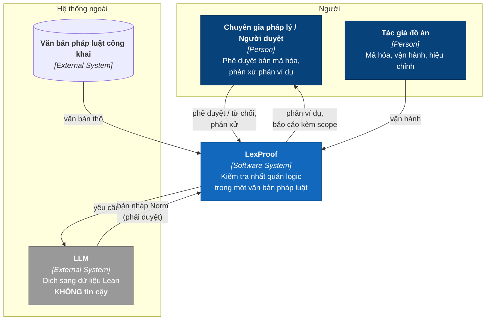
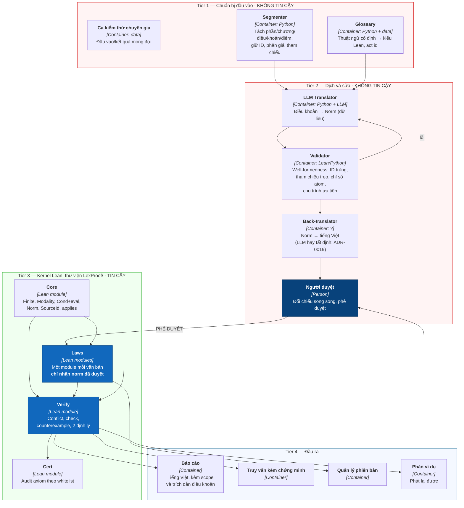
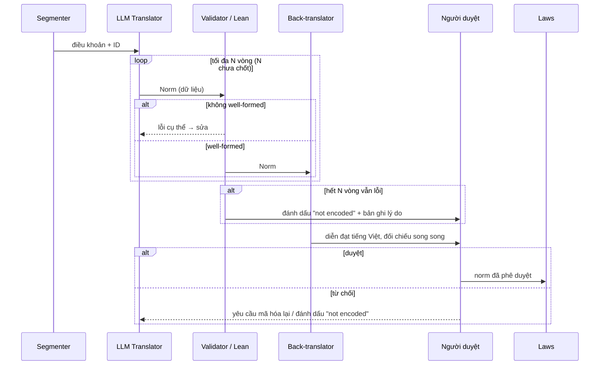
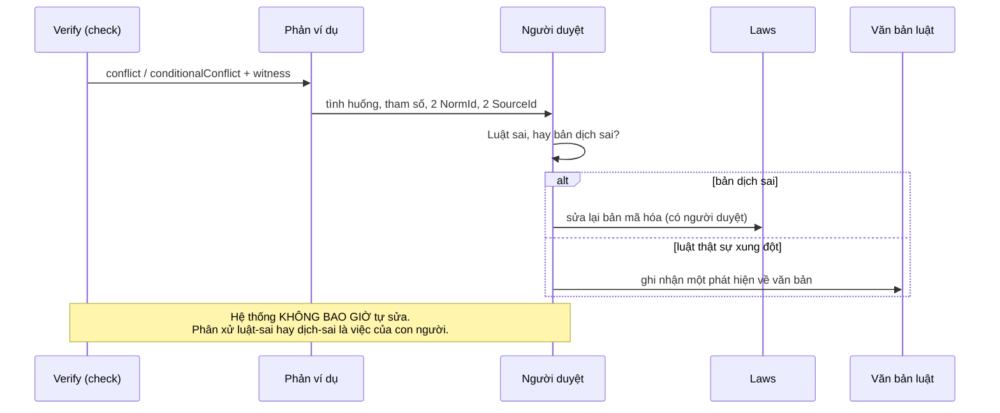

# LexProof — Kiến trúc (HLD)

Khuôn theo **arc42** (chỉ các mục có nội dung thực), sơ đồ theo **C4** vẽ bằng
Mermaid. Thiết kế chi tiết của tầng Lean: [design-core.md](design-core.md).

---

## 1. Mục tiêu và yêu cầu

LexProof kiểm tra **tính nhất quán logic trong một văn bản pháp luật** tiếng
Việt: cùng một tình huống mà có nghĩa vụ / cấm / cho phép xung đột nhau và
không có thứ tự ưu tiên rõ ràng, cộng với tham chiếu treo.

Ba mục tiêu chất lượng, theo đúng thứ tự ưu tiên:

| # | Mục tiêu | Vì sao đứng ở vị trí này |
|---|---|---|
| G1 | **Soundness** — kernel Lean chấp nhận chứng minh | Nếu mất, mọi kết luận vô giá trị |
| G2 | **Faithfulness** — bản mã hóa khớp với luật | Không chứng minh được bằng máy; chỉ người và ca kiểm thử chuyên gia nói lên được |
| G3 | **Honest scope** — không bao giờ khẳng định quá phần đã mã hóa và đã duyệt | Đây là thứ phân biệt công cụ hữu ích với công cụ gây hại |

G1 và G2 là **hai loại đúng đắn khác nhau** và không được trộn vào nhau. Bằng
chứng cho từng mục tiêu, và những gì mỗi bằng chứng *không* bao phủ, nằm trong
[traceability.md](traceability.md).

Yêu cầu đầy đủ: [requirements.md](requirements.md).

## 2. Ràng buộc

| Ràng buộc | Nguồn |
|---|---|
| Lean 4 `v4.35.0`, ghim trong `lean-toolchain` | N7 |
| **Không Mathlib**, không phụ thuộc ngoài | [ADR-0009](decisions/0009-own-finite-class-no-mathlib.md) |
| Chỉ `decide`; cấm `native_decide`, `bv_decide`, `sorry`, axiom mới | [ADR-0010](decisions/0010-axiom-whitelist-decide-only.md) |
| Miền tình huống hữu hạn | [ADR-0009](decisions/0009-own-finite-class-no-mathlib.md) |
| Chỉ Level 1 | [ADR-0012](decisions/0012-scope-level1-now.md) |
| Môi trường phát triển: Windows / PowerShell; CI: ubuntu | CLAUDE.md |

## 3. Bối cảnh và phạm vi (C4 — Context)



**Trong phạm vi**: một văn bản, Level 1.
**Ngoài phạm vi**: so sánh giữa nhiều văn bản, thứ bậc hiệu lực pháp lý, tư vấn
pháp lý, quyết định về khái niệm mở.

## 4. Chiến lược giải pháp

1. **Đẩy mọi thứ không chắc chắn ra ngoài kernel.** LLM, phân đoạn, glossary đều
   không tin cậy. Chỉ dữ liệu *đã có người duyệt* được vào `Laws`.
2. **Dữ liệu, không phải mã.** LLM sinh ra `Norm` với cây cú pháp `Cond`, không
   sinh mã Lean tự do. Nhờ vậy bản dịch in được, so sánh được, và không thể
   chèn logic lạ ([ADR-0002](decisions/0002-cond-syntax-tree-option-eval.md)).
3. **Miền hữu hạn để kiểm được bằng máy.** Tình huống và khái niệm mở đều hữu
   hạn, nên tìm xung đột là quét cạn, chứng minh bằng `decide`.
4. **Ba/bốn giá trị, fail closed.** Không chắc thì `unknown`, không bao giờ
   im lặng bỏ qua.
5. **Hai vòng phản hồi có người ở giữa** (mục 6). Hệ thống không bao giờ tự sửa
   bản mã hóa dựa trên kết quả kiểm tra của chính nó.

## 5. Khung nhìn khối (C4 — Container), 4 tầng



Trạng thái cài đặt của từng khối:

| Khối | Trạng thái |
|---|---|
| `Core` (`Finite`, `Norm`, `Cond` + `wf`, `Atoms.valid`) | **Implemented** |
| `Verify` (`Conflict`, `cands`, `check`, `analyze`, định lý (a)–(f), smoke, 9 nhóm test) | **Implemented** |
| Validator (`Verify/Validate.lean`: `Finding`, `validate`) | **Implemented** — [ADR-0017](decisions/0017-wellformedness-validator-first.md) |
| `Laws` | **Planned** — thư mục rỗng |
| `Cert` (`Cert/Audit.lean`: `#audit_axioms`, `#audit_encapsulation`) | **Implemented** — chạy trong mỗi `lake build`, làm build đỏ khi vi phạm. Đề xuất cho phần quy mô: [ADR-0020](decisions/0020-untrusted-search-kernel-certificate.md) |
| Segmenter, Glossary, Translator, Back-translator | **Planned** — `pipeline/` rỗng |
| Ca chuyên gia, báo cáo, truy vấn, phiên bản | **Planned** — `eval/`, `reports/` rỗng |

## 6. Khung nhìn thời gian chạy — hai vòng phản hồi

### Loop A — sửa lỗi dịch (trước khi vào Laws)



Điểm then chốt: **không có mũi nào đi từ LLM trực tiếp vào `Laws`**. Mọi đường
vào `Laws` đều qua người duyệt (FR5, [ADR-0011](decisions/0011-trust-boundary-human-approval.md)).

### Loop B — phán xử phản ví dụ (sau khi kiểm tra)



## 7. Khái niệm xuyên suốt

### 7.1 Trust boundary

```
KHÔNG TIN CẬY                      │  TIN CẬY
Tier 1, Tier 2                     │  Tier 3 (kernel Lean + LexProof/)
Python, LLM, segmenter, glossary    │  Core, Laws, Verify, Cert
───────────────────────────────────┼──────────────────────────────────
Cổng duy nhất: NGƯỜI DUYỆT PHÊ DUYỆT
```

Mọi thứ ngoài Lean là không tin cậy. Nhưng **kernel không phải là toàn bộ cơ sở
tin cậy**: các định nghĩa `Conflict`, `Norm.applies`, `Norm.resolved`,
`Incompatible`, `Cond.eval` nằm *cùng* kernel trong trust base, và **không có gì
chứng minh chúng khớp với luật**. Danh sách đầy đủ và hệ quả: bảng trust base
trong [traceability.md](traceability.md).

### 7.2 Kết quả nhiều giá trị và fail-closed

`check` trả về đúng một trong bốn: `conflict`, `conditionalConflict`,
`consistentOn scope`, `unknown reason`. Không có giá trị nào nghĩa là "văn bản
đúng". `consistentOn` chỉ nói về `ns` được truyền vào, trong miền `|S| × |P|`
được liệt kê.

Khi không đánh giá được (chỉ số atom sai), `Cond.eval` trả `none` và kết quả
thành `unknown` — không bao giờ lặng lẽ thành `false`
([ADR-0002](decisions/0002-cond-syntax-tree-option-eval.md)).

### 7.3 Chính sách axiom

Whitelist `{propext, Classical.choice, Quot.sound}`. `native_decide` và
`bv_decide` bị cấm vì cả hai đều thêm axiom sinh theo từng định lý khi thực sự
phải gọi trình giải; `sorryAx` bị cấm vì `decide` thất bại sẽ *im lặng* để lại
nó. Chi tiết và số liệu đo: [ADR-0010](decisions/0010-axiom-whitelist-decide-only.md).

### 7.4 Ngân sách liệt kê

Chi phí `|S| × |P| × số cặp norm`. Trần kế hoạch 2^14; nhóm norm theo `act` để
giảm số cặp. Số đo và giới hạn: N8 trong [requirements.md](requirements.md).

## 8. Quyết định kiến trúc

19 ADR theo khuôn MADR: [decisions/README.md](decisions/README.md).

## 9. Rủi ro và nợ kỹ thuật

| # | Rủi ro / nợ | Mức | Xử lý |
|---|---|---|---|
| R2 | Faithfulness không chứng minh được; trust base gồm **6** định nghĩa người viết (nay thêm `Atoms.valid`) | Cao | G2: ca chuyên gia + duyệt chéo (FR12, N4) |
| R11 | **`Atoms.valid` quá mạnh sẽ che xung đột thật** và không định lý nào phát hiện được — mọi định lý đều có dạng "trên phần `valid`" | Cao | Duyệt `valid` như duyệt một norm; `Scope.validRestricted` để người đọc thấy |
| R14 | **Chu trình ưu tiên từ 3 norm trở lên lừa được bộ kiểm trần**: `resolved` là XOR theo cặp nên mọi cặp trông như đã giải quyết | Thấp | Nay có **định lý**: mọi kết quả đã quét của `analyze` kèm bảo đảm không có chu trình (`no_priority_cycle_of_*`), nên hiểm họa không lọt qua điểm vào. Định nghĩa `resolved` vẫn giữ nguyên (theo D40) |
| R5 | Nổ tổ hợp khi `\|S\|` lớn; chưa có chốt ngân sách | Trung bình | N8; `unknown(outOfBudget)` chưa cài; [ADR-0020](decisions/0020-untrusted-search-kernel-certificate.md) |
| R12 | Validator chỉ có **một** định lý (`wf_of_validate_nil`); phát hiện chu trình ưu tiên, trùng id và tham chiếu treo chỉ được kiểm bằng test | Trung bình | Chứng minh thêm, hoặc chấp nhận và nói rõ |
| R13 | `Audit.resolutions` không có định lý nói nó liệt kê đủ và đúng | Thấp | Chứng minh khi báo cáo dựa vào nó |
| R9 | `LexProof/Basic.lean` và `Main.lean` vẫn là mẫu `lake new` (`def hello`), và `lexproof` là target build mặc định | Thấp | Dọn riêng |
| R10 | Mỗi văn bản mới phải viết tay instance `Finite`; chỉ có sẵn `Unit`, `Bool`, `×` | Thấp | Cân nhắc deriving handler sau |

**Đã đóng**: R1 (`lake build` trần nay biên dịch mọi module, N12),
R3 (nhãn đã có định lý đặc trưng, [ADR-0015](decisions/0015-characterize-conflict-labels.md)),
R4 (validator đã có, [ADR-0017](decisions/0017-wellformedness-validator-first.md)),
R6 (`resolved` nay là XOR, chu trình bị báo, norm thắng được ghi, [ADR-0013](decisions/0013-directional-priority-and-cycles.md)),
R7 (so cặp không thứ tự, [ADR-0014](decisions/0014-compare-pairs-by-index.md)),
R8 (audit axiom nay tự động trong `lake build`, FR11),
R12 (validator nay có thêm `cycle_of_validate_finding` và `singleDocId_isSome_of_validate_nil`; completeness chu trình thì chuyển thành R14),
R13 (`resolution_has_witness` đã chứng minh),
R15 (negative test của audit nay chạy cố định trong CI: `ci/audit-negative.sh`),
R16 (build lạnh về **30.7s** sau khi hạ n=3 xuống `#eval` và tính `gnodes` một lần).

## 10. Thuật ngữ

| Thuật ngữ | Nghĩa trong LexProof |
|---|---|
| Norm | Một điều khoản đã hình thức hóa, kiểu `Norm` |
| Situation (`S`) | Kiểu hữu hạn mô tả tình huống, do mỗi văn bản tự khai |
| Open-textured concept | Khái niệm mở ("hợp lý", "nghiêm trọng"), là tham số `P`, hệ thống không tự quyết |
| Act | Id hành vi, chuỗi mờ lấy từ glossary |
| Modality | obligation / prohibition / permission |
| Priority | Ưu tiên tường minh; thiếu nó nghĩa là *chưa* giải quyết |
| Scope | Phần đã mã hóa và đã quét mà một khẳng định nhất quán nói về |
| Trust base | Kernel Lean **cộng** các định nghĩa mà con người viết và không chứng minh được |
| Soundness (G1) | Kernel chấp nhận chứng minh |
| Faithfulness (G2) | Bản mã hóa khớp với luật |
