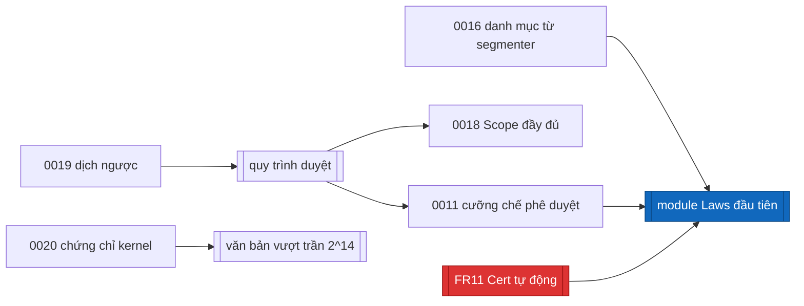

# Quyết định kiến trúc (ADR)

Khuôn **MADR**. Mỗi tệp một quyết định, số tăng dần, không sửa nội dung cũ —
muốn đổi thì thêm ADR mới và đánh dấu cái cũ là superseded.

Mỗi ADR có hai trạng thái khác nhau, đừng lẫn:

- **Status** — trạng thái của *quyết định*: `Accepted`, `Proposed`,
  `Superseded`.
- **Trạng thái cài đặt** — trạng thái của *code*: `Implemented`, `Planned`,
  `Open`.

Một quyết định có thể `Accepted` mà vẫn `Planned`: đã chốt làm, chưa viết code.

## Đã cài (Implemented)

| ADR | Quyết định |
|---|---|
| [0001](0001-incompatible-modalities.md) | Cặp modality xung đột: obligation~prohibition và permission~prohibition; **không** obligation~permission |
| [0002](0002-cond-syntax-tree-option-eval.md) | `Cond` là cây cú pháp; `eval` trả `Option Bool`, `none` = dị dạng |
| [0003](0003-open-concepts-as-finite-parameters.md) | Khái niệm mở là tham số hữu hạn `P`, mỗi khái niệm một `Bool`, tính vào ngân sách |
| [0004](0004-act-as-opaque-glossary-id.md) | `act` là id mờ từ glossary, không có cấu trúc |
| [0005](0005-exceptions-vs-priority.md) | Ngoại lệ đổi *khi nào* áp dụng; ưu tiên giải quyết hai norm *cùng* áp dụng; không lex specialis ngầm |
| [0006](0006-defer-subject-and-time.md) | Hoãn chủ thể và thời gian; `S` do người gọi cung cấp |
| [0007](0007-keep-level2-fields-in-sourceid.md) | Giữ `docId`, `docType`, `effective` trong `SourceId` cho Level 2 |
| [0008](0008-report-conditional-conflicts.md) | Xung đột có điều kiện được báo riêng, kèm tên tham số |
| [0009](0009-own-finite-class-no-mathlib.md) | Miền hữu hạn, không Mathlib, tự viết lớp `Finite` |
| [0010](0010-axiom-whitelist-decide-only.md) | Axiom theo whitelist; chỉ `decide`; cấm `native_decide`, `bv_decide`, `sorryAx` |
| [0012](0012-scope-level1-now.md) | Chỉ Level 1; Level 2 về sau |
| [0013](0013-directional-priority-and-cycles.md) | `resolved` chỉ đúng khi **đúng một** norm override norm kia (XOR); override lẫn nhau là finding chu trình; `Audit.resolutions` ghi norm thắng |
| [0014](0014-compare-pairs-by-index.md) | So cặp **không thứ tự**, mỗi cặp một lần, bỏ cặp khác `act`; ID trùng là finding |
| [0015](0015-characterize-conflict-labels.md) | Ngữ nghĩa (a) cho hai nhãn, **có định lý đặc trưng**: `conflict_all_params`, `conditionalConflict_split` |
| [0017](0017-wellformedness-validator-first.md) | Validator chạy trước bộ kiểm; `unknown` chỉ còn là chốt fail-closed |

## Đã cài một phần (Planned phần còn lại)

| ADR | Đã có | Còn thiếu |
|---|---|---|
| [0011](0011-trust-boundary-human-approval.md) | Tách `LexProof/` khỏi `pipeline/`; LLM sinh dữ liệu chứ không sinh mã | Cơ chế cưỡng chế phê duyệt; `Laws/` vẫn rỗng |
| [0016](0016-reference-catalog-from-segmenter.md) | Danh mục tham chiếu đã là **tham số** của `validate`, và tham chiếu treo đã bị bắt | Danh mục chưa do segmenter sinh, chưa có bước duyệt, chưa ghi vào `Scope`; chưa phân biệt "treo" với "trỏ tới phần chưa mã hóa" |
| [0018](0018-scope-lists-parameter-names.md) | `Scope.validRestricted` nói miền đã bị thu hẹp | `Scope` chưa liệt kê **tên** tham số khái niệm mở, chưa có trạng thái duyệt, chưa có danh sách điều khoản bỏ qua |

## Chưa quyết định (Open / Proposed)

| ADR | Câu hỏi |
|---|---|
| [0019](0019-back-translation-renderer.md) | Dịch ngược bằng LLM hay renderer tất định? Khuynh hướng: **tất định**, vì LLM có lỗi tương quan với bước dịch xuôi |
| [0020](0020-untrusted-search-kernel-certificate.md) | Cho phép phép tìm kiếm chạy đã biên dịch, nhưng mọi kết luận "đã kiểm chứng" phải có chứng chỉ kernel kiểm. Điểm cốt lõi: **chỉ khẳng định tồn tại có chứng chỉ nhỏ**; khẳng định nhất quán thì không, nên không được lợi gì |

## Chưa có ADR riêng

**Ràng buộc toàn vẹn `Atoms.valid`** (đã cài): loại bỏ các cặp `(π, s)` không
thể xảy ra; bộ kiểm chỉ xét cặp `valid`; `Scope.validRestricted` ghi lại việc
miền bị thu hẹp. `valid` **nằm trong trust base** — một `valid` quá mạnh sẽ che
xung đột thật và không định lý nào phát hiện được. Hiện được mô tả ở
[../design-core.md](../design-core.md) §2.2 và trong bảng trust base của
[../traceability.md](../traceability.md), chưa có ADR riêng.

## Thứ tự phụ thuộc giữa các việc còn lại

Việc chặn gần nhất không còn là chứng minh mà là **quy trình**: `Laws` cần cơ
chế phê duyệt (0011) và `Cert` tự động (FR11). ADR-0020 chỉ cấp thiết khi một
văn bản thật vượt trần quy mô.
