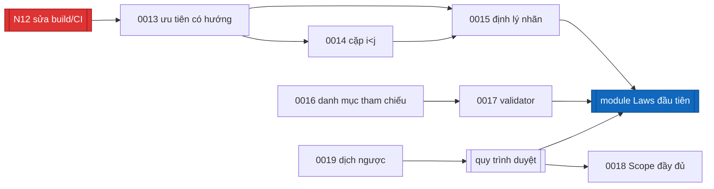

# Quyết định kiến trúc (ADR)

Khuôn **MADR**. Mỗi tệp một quyết định, số tăng dần, không sửa nội dung cũ —
muốn đổi thì thêm ADR mới và đánh dấu cái cũ là superseded.

Mỗi ADR có hai trạng thái khác nhau, đừng lẫn:

- **Status** — trạng thái của *quyết định*: `Accepted`, `Proposed`,
  `Superseded`.
- **Trạng thái cài đặt** — trạng thái của *code*: `Implemented`, `Planned`,
  `Open`.

Một quyết định có thể `Accepted` mà vẫn `Planned`: đã chốt làm, chưa viết code.

## Đã cài (Implemented)

| ADR | Quyết định |
|---|---|
| [0001](0001-incompatible-modalities.md) | Cặp modality xung đột: obligation~prohibition và permission~prohibition; **không** obligation~permission |
| [0002](0002-cond-syntax-tree-option-eval.md) | `Cond` là cây cú pháp; `eval` trả `Option Bool`, `none` = dị dạng |
| [0003](0003-open-concepts-as-finite-parameters.md) | Khái niệm mở là tham số hữu hạn `P`, mỗi khái niệm một `Bool`, tính vào ngân sách |
| [0004](0004-act-as-opaque-glossary-id.md) | `act` là id mờ từ glossary, không có cấu trúc |
| [0005](0005-exceptions-vs-priority.md) | Ngoại lệ đổi *khi nào* áp dụng; ưu tiên giải quyết hai norm *cùng* áp dụng; không lex specialis ngầm |
| [0006](0006-defer-subject-and-time.md) | Hoãn chủ thể và thời gian; `S` do người gọi cung cấp |
| [0007](0007-keep-level2-fields-in-sourceid.md) | Giữ `docId`, `docType`, `effective` trong `SourceId` cho Level 2 |
| [0008](0008-report-conditional-conflicts.md) | Xung đột có điều kiện được báo riêng, kèm tên tham số *(phần chứng minh còn thiếu — xem 0015)* |
| [0009](0009-own-finite-class-no-mathlib.md) | Miền hữu hạn, không Mathlib, tự viết lớp `Finite` |
| [0010](0010-axiom-whitelist-decide-only.md) | Axiom theo whitelist; chỉ `decide`; cấm `native_decide`, `bv_decide`, `sorryAx` |
| [0011](0011-trust-boundary-human-approval.md) | Biên tin cậy: pipeline không tin cậy, người duyệt là cổng duy nhất vào `Laws` *(cơ chế còn là quy ước)* |
| [0012](0012-scope-level1-now.md) | Chỉ Level 1; Level 2 về sau |

## Đã chốt, chưa cài (Planned)

| ADR | Quyết định | Vì sao chưa làm được ngay |
|---|---|---|
| [0013](0013-directional-priority-and-cycles.md) | `resolved` chỉ đúng khi **đúng một** norm override norm kia; chu trình là finding; `Result` ghi ai thắng | Đổi ngữ nghĩa `Conflict` ⇒ phải chứng minh lại cả hai định lý chính |
| [0014](0014-compare-pairs-by-index.md) | So cặp theo `i < j`; ID trùng là finding | Phải phát biểu lại định lý (b); phải làm cùng 0013 vì liên quan tính đối xứng |
| [0015](0015-characterize-conflict-labels.md) | Chốt ngữ nghĩa hai nhãn và **bắt buộc** có định lý đặc trưng trước `Laws` | Là cửa chặn trước module `Laws` đầu tiên |
| [0016](0016-reference-catalog-from-segmenter.md) | Danh mục tham chiếu từ segmenter, có người duyệt, ghi vào `Scope` | Cần segmenter (FR1) |
| [0017](0017-wellformedness-validator-first.md) | Validator chạy trước bộ kiểm; `unknown` dành cho lý do khác | Sửa luôn hai khuyết điểm đã xác nhận: `unknown` báo sai tên norm, và xung đột che lỗi cấu trúc |
| [0018](0018-scope-lists-parameter-names.md) | `Scope` liệt kê tên tham số và trạng thái duyệt | Phần trạng thái duyệt cần quy trình duyệt tồn tại trước |

## Chưa quyết định (Open)

| ADR | Câu hỏi |
|---|---|
| [0019](0019-back-translation-renderer.md) | Dịch ngược bằng LLM hay renderer tất định? Khuynh hướng: **tất định**, vì LLM có lỗi tương quan với bước dịch xuôi |

## Thứ tự phụ thuộc giữa các việc còn lại

Đọc sơ đồ: **N12 (sửa build và CI) nên làm trước tiên** — hiện `lake build`
trần không build `Core`/`Verify`, nên mọi việc chứng minh lại ở 0013–0015 sẽ
diễn ra mà CI không kiểm được gì. Xem N12 trong
[../requirements.md](../requirements.md).
